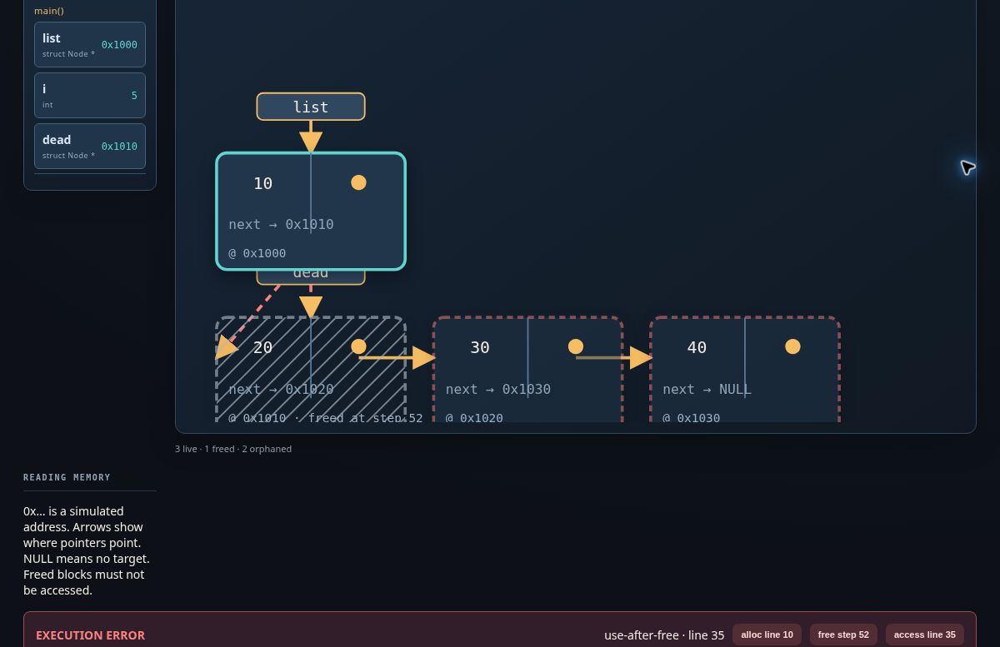
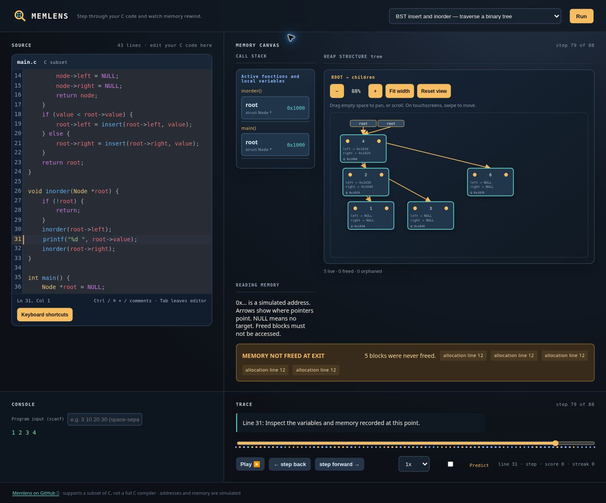

<p align="center">
  
</p>

<h1 align="center">Memlens</h1>
<p align="center"><strong>Step through your C code. See the pointers. Rewind the mistake.</strong></p>

**Try Memlens:** [memlensc.vercel.app](https://memlensc.vercel.app/)

Memlens is a browser-based learning tool for C data structures and memory. Edit a program, run it, then explore its recorded execution one change at a time: stack frames, heap allocations, pointer arrows, and memory errors.

> **A teaching tool, not a full C compiler.** Memlens interprets a supported subset of C using simulated memory. It does not compile or execute native C, and its diagnostics can differ from gcc/clang or real hardware.

[Quick start](#try-it-in-a-minute) · [What you can explore](#what-you-can-explore) · [Controls](#controls) · [C support](#supported-c-subset) · [Run locally](#run-locally)

## See memory, not just output



*The list example at step 29: source, active stack frames, four allocated nodes, and the reversible timeline. Later, this sample deliberately accesses a freed node so you can trace how the bug happens.*

## Try it in a minute

New to the workspace? Choose **Start quick tour** in the welcome card, or reopen it from **Help → Start tutorial**. You can skip it or exit at any point; the tour uses a temporary example and restores your previous source and test setup.

1. Open the [main demo](https://memlensc.vercel.app) and paste your own C program into Source, or choose a sample.
2. If your program uses `scanf`, enter its values in **Console → Program input**, or select **Interactive console** in the Source panel to answer prompts during execution.
3. Click **Run** to record execution.
4. Step forward and backward. Watch the current explanation, console, call stack, and heap change together.
5. Zoom or pan the memory view to follow pointers. When an error appears, step backward to find what caused it.

Try a [shared Factorial example](https://memlensc.vercel.app/#sample=factorial): choose **Load sample**, then **Run** to trace the recursion that prints 120. Opening the link alone leaves your editor and test setup untouched. For any unedited built-in sample, **Share sample** gives you a link to the example, not to private editor contents or program input.

Try the [doubly linked list sample](https://memlensc.vercel.app/#sample=doubly-linked-list) to follow `next` from head to tail and `prev` back again. Step through the two print loops to see the current pointer move over the same three nodes in opposite directions.

Try [Swap two tree children](https://memlensc.vercel.app/#sample=tree-swap) and step through its three pointer assignments. In the middle, both links point to the same node while `saved` keeps the original left child reachable. After the swap, the children trade sides but keep their addresses.

Try [BFS / DFS](https://memlensc.vercel.app/#sample=graph-traversal) to follow the waiting BFS queue and the active recursive DFS calls as you step or rewind. For your own code, select **View as graph** on a square numeric adjacency matrix with up to 16 vertices. Each nonzero entry is an edge, including weighted edges and self-loops. The default is directed; you can choose an undirected view when the matrix is symmetric. Traversal labels are provided for the bundled sample only, not inferred from arbitrary variable names.

After running, step until the variable is visible in **Memory → Call Stack**. Arrays and matrices are shown there. Eligible variables have buttons for graph, stack, queue, or heap-matrix views. A missing button does not mean the code is invalid; Memlens does not infer arbitrary diagram shapes.

[Report a problem on GitHub](https://github.com/gagang2109/Memlens/issues). Issues are public; include only the C code and input you choose to share. Memlens does not attach them automatically.

## What you can explore

| Learn by doing | What Memlens shows |
| --- | --- |
| **Follow pointers** | Linked-list and binary-tree layouts, heap addresses, pointer arrows, and NULL targets. |
| **Understand execution** | Reversible steps, a timeline, call frames, console output, and playback speeds from 0.5× to 4×. |
| **Investigate memory bugs** | Diagnostics for invalid memory operations, freed-block markers, and reports of leaked or orphaned allocations. |
| **Practice data structures** | Bundled list, tree, stack, queue, recursion, and memory-error examples. |
| **Predict the next state** | Pointer-target questions with a locally saved score and streak. |
| **Write code here** | CodeMirror syntax highlighting, bracket matching, find/replace, undo/redo, and familiar editing shortcuts. |

<details>
<summary><strong>Explore a binary search tree</strong></summary>



The bundled BST sample during inorder traversal, with the diagram zoomed out to show every node. The amber warning is a whole-run summary: this sample does not free its five allocations before exit, even while you inspect an earlier step.

</details>

## Controls

| Where | Shortcut or control | Action |
| --- | --- | --- |
| Workspace or editor | Ctrl / ⌘ + Enter | Run the current code |
| Workspace or editor | Shift + Enter | Run and play; ignored in other text fields and menus so input stays usable |
| Editor | Ctrl / ⌘ + `/` | Toggle comments on selected lines |
| Editor | Alt + Shift + A | Alternate comment toggle |
| Editor | Ctrl / ⌘ + `F` | Find and replace |
| Editor | Ctrl / ⌘ + `Z` / Ctrl / ⌘ + Shift + `Z` | Undo / redo |
| Workspace outside text fields | `?` (Shift + / on US keyboards) or **Help** | Open keyboard shortcuts and usage help; dismiss with Esc |
| Playback | `←` / `→` | Step backward / forward |
| Playback | `Space` | Play / pause |
| Playback | `+` / `-` | Increase / decrease speed between 0.5× and 4× |
| Playback | `=` | Reset playback speed to 1× |
| Playback | `Home` / `End` | Jump to the first / last step |
| Playback | **Previous event** / **Next event** | Jump to calls, returns, allocations, frees, warnings and errors |
| Memory view | `−` / `+`, **Fit width**, **Reset view** | Adjust the diagram from 25% to 300% zoom |
| Memory view | Drag empty space, scroll, or swipe | Move around the diagram |

In **Call Stack**, one-dimensional arrays show zero-based indexes, and matrices show rows and columns in the same order as `a[row][column]`. Large arrays have page controls. If a change is off the current page, **Show next changed page** takes you there.

Gold highlights show changed stack values, array cells, and recorded heap fields relative to the previous recorded step. Hover a changed heap card for its before/after values. Rewind selects the original highlights for that earlier step.

The timeline slider reaches every recorded step. Long traces show fewer clickable markers, but the event buttons still reach every recorded event. Playback shortcuts stay out of the editor and interactive controls. **Tab** moves focus between controls rather than trapping it inside the editor.

## Practice without `main`

Choose **Array sum snippet — no main needed**, or write supported C statements directly:

```c
int values[] = {4, 7, 2};
int total = 0;
for (int i = 0; i < 3; i++) total += values[i];
printf("%d", total);
```

Memlens executes top-level statements in source order without adding hidden wrapper lines. Define the variables and data your snippet needs. Function definitions can accompany a snippet, but you must call them explicitly with your chosen arguments; Memlens does not invent test data or auto-call functions. A bare expression does not automatically print its value: use `printf`.

This is a teaching extension, not standard standalone C syntax: native C programs normally need an entry point such as `main`. Existing full programs continue to work. If you mix top-level statements with a `main` function, those statements run before `main`.

## Supported C subset

Designed for small C and data-structures exercises: functions and recursion, structs and pointers, fixed-size arrays (including two-dimensional arrays), loops, branching, and a selection of memory and input/output functions.

<details>
<summary><strong>Expand the language and library support reference</strong></summary>

The interpreter currently supports:

- Integer, character, `short`, `long`, `long long`, `unsigned`, `float`, `double`, `void`, `struct`, and typedef-defined struct names, with `struct Node *p` declarations.
- `const` and `static` qualifiers, multiple declarators, function prototypes, and the common `main` signatures.
- Pointer declarations, casts, pointer arithmetic, dereference, address-of, indexing, and pointer values.
- Pointer-to-pointer parameters and address-of expressions for variables, fields, and indexed elements.
- Struct declarations with fields, including pointer fields such as `next`, `left`, and `right`.
- `int` and `char` arrays, array initializers, array indexing, array parameters, two-dimensional arrays, and arrays of struct values. Simple local declarations can use a size read at runtime, such as `scanf("%d", &n); int a[n];`. Pass a local `int` or `char` matrix to a helper such as `void bfs(int graph[][N], int start)` when the column count is fixed and matches the matrix.
- Struct values, the `.` operator, and passing struct addresses to functions.
- Named structs consisting of plain `int` fields can contain one-dimensional fixed `int` array members, with literal bounds or simple integer macros. Declare the object without an initializer directly in a function body. Member cells and scalar fields appear in Call Stack and rewind with the trace. A member from a supported struct with `int front, rear` can explicitly be viewed as a linear queue, using inclusive indexes and `-1, -1` for empty. This mode does not infer circular-queue state. Char array members, by-value copies, nesting, static or global instances, and heap allocation of these structs are outside this subset.
- Variables, assignments (including chained assignment), compound assignments (`+=`, `-=`), arithmetic, comparisons, logical operators, the conditional operator (`?:`), unary `!`, unary `-`, dereference (`*`), address-of (`&`), and increment/decrement.
- Integer, character, string, and `NULL` literals. Quoted literals decode escaped quotes/backslashes, standard simple escapes (such as `\n`, `\t`, and `\0`), and octal/hexadecimal escapes in the byte range 0–255. Multi-character character literals, universal character escapes, and line-spliced literals are not modeled; malformed or unsupported escapes report a parse error.
- `if`/`else`, `while`, `do`/`while`, `for`, `break`, `continue`, and `switch`/`case`/`default`.
- User-defined functions, parameters, return values (including an `int **` returned by a heap-matrix constructor), and recursion.
- `malloc`, `calloc`, `realloc`, `free`, limited `sizeof` type, pointee, and fixed-array forms (see limits below), `strlen`, `strcpy`, `strcmp`, `strcat`, `memset`, `getchar`, `exit`, and `printf` with `%d`, `%c`, `%s`, `%p`, `%f`, `%lf`, `%zu` for sizes, width, precision, and `%%`.
- For a supported heap-backed `int **` matrix, choose **View … as heap matrix** in Call Stack. The view separates pointer-slot addresses from independently allocated row cells and follows both values and free events during playback. Indexed cells and the equivalent expressions rooted at a named matrix, such as `*(*(marks + i) + j)` and `scanf("%d", *(marks + i) + j)`, use the same simulated addresses. This view does not treat a local contiguous 2D array as a heap matrix. General pointer differences and one-past arithmetic are not supported by this heap-matrix subset.
- Fixed `char` arrays in supported local structs accept bounded `scanf` input (for example, `scanf("%19s", record.name)` for a 20-cell field), including `%c` and bracket scansets. `printf("%s", record.name)`, `strlen`, and `strcmp` can read the field after you initialize the characters and terminator. Brace initializers and string-library writes such as `strcpy(record.name, text)` are not modeled here.
- A local fixed-size array of up to 32 such records supports direct member access such as `rows[i].score` and `scanf("%19s", rows[i].name)`. Call Stack shows the indexed records at stable addresses as you step or rewind. Direct same-type copy statements and copy initialization such as `struct Row temp = rows[0]; rows[0] = rows[1]; rows[1] = temp;` copy all fields into the destination's own storage. A named array can be passed to a matching helper parameter (`struct Row a[]` or `struct Row *a`) for indexed field operations, whole-record copies or forwarding to another helper. The caller still owns the original records. A non-static, non-const record temporary can live inside a nested block, such as a sort’s swap block. It disappears from Call Stack when the block ends. Record arrays must be declared directly in a function body. Rebinding the parameter, general pointer arithmetic, and using record assignment inside a larger expression are not supported.
- A matching single pointer can select a local fixed-field record with `struct Row *best = &rows[i]`, be rebound with `best = &rows[j]`, and read or update fields through `best->field`. Call Stack records the same addresses as the original records. Index bounds and record lifetimes still apply; For a fixed record array, `struct Row *best = rows`, `best = rows + i`, and `(rows + i)->field` select a record in the original array. Named aliases may also be offset in a binding or member expression when their original array is still live. One-past pointers, pointer differences, pointer increment and general casts are not modeled.
- Direct local arrays of named structs containing only `int` fields also support positional brace initialization, for example `struct Term a[3] = {{0,2,4}, {1,0,5}};`. Omitted fields and records initialize to zero. Call Stack shows the fields in contiguous local slots, including arrays declared alongside an initialized one. The same fixed bounds apply; designated initializers and mixed flat/grouped syntax are not modeled.
- Fixed-field local records may include scalar `char` fields for values such as letter grades. `scanf(" %c", &row.grade)` accepts one byte; wider conversions must use a character buffer.
- Supported fixed-field local records may include scalar `float` fields. Assigning a finite number stores it at single precision; the visualizer preserves fractional values through comparisons, record copies, and rewind. `scanf("%f", &row.marks)` can fill a field. Float array members are not supported.
- Use `printf("%zu", sizeof a)` to print a supported array size. `%zu` also formats other nonnegative integers in the exact numeric range; it does not implement unsigned wrapping or general `size_t` declarations.
- Printf formatting supports literal widths, left alignment, numeric signs/zero padding, integer/string precision, and floating precision up to 100. Width and other precision values are capped at 10,000 to bound browser allocations. Return counts include padding and `%c` bytes. String formatting is intended for basic ASCII teaching examples; non-ASCII string precision, locale-dependent formatting, exact native floating-point tie rounding, dynamic `*` widths, and other conversion specifiers are not modeled. Unsupported or incomplete conversions produce a simulator error rather than silently misaligning arguments.
- `getchar` returns `EOF` (`-1`) once input is exhausted and shares the input position with `scanf`. Non-EOF character values retain the simulator’s existing string-backed representation, so comparisons with numeric character codes (for example, `getchar() == 65`) are not fully C-compatible. This is not a full C byte-stream/encoding implementation.
- `isspace`, `isalnum`, and `isdigit` use the C locale. They accept `EOF` or codes 0–255, honor a direct `(unsigned char)` integer argument cast, and return 1 or 0. This does not add locale switching or general cast support.
- `scanf` for `%d`, `%c`, and `%s` using the app's standard-input field, including repeated whitespace-separated input and indexed lvalue targets. Bracket scansets work with writable fixed `char` struct members, suitable heap buffers, or one-dimensional local `char` buffers declared directly in a function body. With `char expr[80]; scanf("%79[^\n]", expr);`, spaces are retained, the newline stays unread, and a successful conversion adds a terminating NUL. Use a width at least one smaller than the buffer capacity.
- `scanf("%f", &mark)` accepts finite decimal input into a writable named `float` scalar or supported fixed-record float field, including signed values, decimal exponents, field width, and assignment suppression. The result rounds to single precision. Hexadecimal floats, infinity/NaN, `%lf` input, and float array cells or heap destinations are not supported.
- Read ASCII string literal bytes with `text[i]`, including through a named `char *` or `const char *` parameter. Indexing includes embedded NUL bytes and the final terminator. The simulator reports out-of-bounds indexes and rejects writes; taking the address of a literal byte and non-ASCII literal indexing are not modeled. Named character arrays remain independently writable.
- Numeric and string `#define` constants. `#include` lines are accepted and ignored.
- `//` and `/* ... */` comments.

It does not currently support:

- Full variable-length array semantics, including pointer-to-array declarators, runtime column counts in matrix parameters, and general variable-length array expressions. Matrix parameters support cell indexing (`graph[row][col]`), not row values.
- Function pointers, unions, variadic functions, general pointer arithmetic beyond supported element indexing, and preprocessor directives other than numeric/string `#define` and ignored `#include`.
- The full C standard library or compilation with gcc/clang.

</details>

### Important limits

- Each local array is limited to **65,536 simulated bytes** (for example, 65,536 `char` elements or 16,384 `int` elements). Every dimension must be a positive integer, and multidimensional totals count toward the same cap. Reduce the array dimensions if this limit is reported; validation occurs before allocating array storage to keep accidental oversized inputs from freezing the browser. A one-dimensional omitted bound (`int a[] = {1,2}` or `char text[] = "abc"`) is inferred from its initializer. Other omitted-bound forms need explicit dimensions. This per-array guard is not a total memory budget and does not promise general variable-length-array support.

- This is a **subset interpreter**, not a standards-complete C implementation. Unsupported syntax or library calls may need a simpler equivalent.
- Function pointers, unions, and the full C preprocessor/library are not supported.
- Ordinary division preserves fractions for supported scalar float and double expressions, including decimal literals like `3.0f` and `3e0`. Integer-only division truncates toward zero. The VM uses JavaScript numbers, not exact per-type C floating precision or machine layout, and still diagnoses division by zero.
- `*=`, `/=`, and `%=` support writable signed `int` targets and supported signed integer expressions, including character literals. Floating-point compound arithmetic, unsigned/long arithmetic, and struct member targets are outside this subset. Division and remainder by zero, and signed overflow in these operations, stop with a diagnostic.
- Addresses and object sizes are simulated; the app is not a substitute for a native debugger or sanitizer.
- `sizeof` knows the declared sizes of fixed `int` and `char` arrays, including rows and elements (`sizeof a`, `sizeof *a`, and `sizeof a[i]`). Use literal bounds or supported integer constant expressions. Indices in supported forms are checked for type, but never evaluated: `sizeof a[i++]` does not change `i`, and no array element is accessed. Named scalar `int` and `char` variables use their declared simulated size without reading their value. Ordinary signed-int-range integer literals and character constants have the simulated `int` size. Decimal floating literals distinguish `float` (with an `f` suffix) from `double`, and ASCII string literals include the terminating byte. Simple pointer type forms such as `sizeof(int *)` and named pointer operands such as `sizeof *rows` and `sizeof rows[i]` follow their pointer depth without evaluating the pointer or index. Memlens models four-byte pointer slots, not the host ABI; this alone does not add dynamic matrix visualization. For a named local runtime-sized `int` or `char` array, `sizeof a` uses the dimensions saved at declaration. Indexed or dereferenced variable-length array operands, pointer arrays, decayed array parameters, struct arrays, and other expression forms are outside this support. Use explicit counts outside the supported forms.
- Local-array `memset` supports byte ranges in `char` arrays and zero-filling whole `int` elements. Partial-byte or nonzero fills of local integer arrays, and other local object representations, report an unsupported-operation error rather than guessing a machine layout.
- Diagram layouts infer structure from pointer fields and heap edges. Ordinary binary-tree nodes can use `left`/`right` or a single recognized pair of self-referential pointers: `lchild`/`rchild` or `llink`/`rlink`. Common threaded-tree flag fields opt out of alias recognition; successor threads are not ordinary child links. Not every graph has a specialized layout.
- Predict skips local-pointer questions when recursive calls share the same function name: the current trace labels cannot uniquely identify those frames. Stepping and playback still continue normally.
- Source and Predict progress use browser localStorage, not an account or cloud sync. Browser storage can be cleared or unavailable.
- The production JavaScript bundle includes CodeMirror and currently triggers Vite's large-chunk warning.

### Floating terminal

Select **Float terminal** to keep the console visible while reading the code or memory diagram. Drag **Move** to reposition it, or drag **Resize** to change its size. Both controls also work with the arrow keys when focused. **Minimize** tucks the terminal in the bottom corner without losing your input or output; **Restore terminal** brings it back, and **Dock** returns it below the editor.

### Workspace shortcuts and layouts

- **Spotlight** (Ctrl/⌘ + K) searches sample programs and actions. **Reset memory view** resets zoom and pan only. Spotlight asks before replacing edited code or test setup with a sample.
- Drag either **Split View** divider to resize its neighboring panes on desktop, or focus the divider and use the arrow keys. **Focus code**, **Focus memory**, and **Focus terminal** temporarily fill the workspace; **Restore workspace** or Escape returns to your old split.
- After a tree-to-list conversion using supported `lchild/rchild` or `llink/rlink` fields, use **View … as doubly linked list** beside the head pointer in Call Stack. It appears only for a complete reciprocal chain. Rewinding before the links are complete shows the recorded heap, not an invented list.
- Use a pointer’s **Quick Look** button to inspect its recorded address and target without changing the current step.
- **Workspace layout** presets rearrange pane space for writing, tracing, or console work without resetting source or execution.

## Run locally

Requires **Node.js compatible with Vite 6** and npm. Clone the repository, then run:

```sh
git clone https://github.com/gagang2109/Memlens.git
cd Memlens
npm ci
npm run dev
```

Open the local URL printed by Vite, usually [http://localhost:5173](http://localhost:5173).

On Windows PowerShell, use `npm.cmd` in place of `npm` if your execution policy blocks `npm.ps1`.

### Check a change

Run all three checks below before pushing a change; a successful build does not replace the test suite.

```sh
npm test
npm run typecheck
npm run build
```

- **Tests:** Vitest regression tests, including C lab fixtures in [`tests/labs`](tests/labs).
- **Typecheck:** TypeScript checks without emitting files.
- **Build:** Type-checks and creates the production site in `dist/`.

For Vercel, use the **Vite** preset, repository root `./`, build command `npm run build`, and output directory `dist`. The app has no backend, database, or server-side C execution.

## Under the hood

```text
C source → lexer/parser → interpreter + simulated memory → recorded trace → React visualizer
```

| Location | Responsibility |
| --- | --- |
| [`src/lang`](src/lang) | Lexer and parser for the supported C subset |
| [`src/vm`](src/vm) | Memory model, interpreter, trace data, and prediction logic |
| [`src/viz`](src/viz) | Heap reachability, structure detection, and layouts |
| [`src/ui`](src/ui) | Editor, explanations, diagrams, playback, and styles |
| [`src/samples.ts`](src/samples.ts) | Bundled sample programs |
| [`tests/labs`](tests/labs) | C exercises and regression coverage |

The byte-addressable memory model tracks initialized, uninitialized, and freed memory. Recorded steps retain the state needed to revisit stack frames, heap fields, output, and pointer relationships without executing native code.

## Found an example that behaves incorrectly?

[Open an issue](https://github.com/gagang2109/Memlens/issues) with the smallest C program that reproduces it, any program input, the expected result, and what Memlens actually shows. Mention your browser and include a screenshot when the problem is visual. Remove personal data before sharing.

## Possible future directions

Function pointers, unions, a bit-level memory view, links for custom code, and image/GIF export are ideas for future work, **not current features**.

## License

[MIT](LICENSE) · Copyright © 2026 Gagan Ganesh Devadiga

### Practice a function with explicit test data

`main()` is optional for supported snippets. Put your types, helper functions and function in the source editor, then open **Test setup & call** to create inputs and call it. The setup is appended after the source; trace and diagnostic labels distinguish source lines from test-setup lines. No function or arguments are guessed. Use `printf` when you want to display a result. Clear setup before running a complete program with `main()`. Both editor drafts are saved separately in this browser when storage is available.

Choose **Practice tree height — separate test setup** for an editable two-node tree example. Its height convention counts nodes (empty tree 0, leaf 1). Selecting a sample replaces the source and setup, but you can recover the last replaced custom draft using **Restore previous draft**. The runner still supports only Memlens's documented C subset, not arbitrary missing types, libraries or function signatures.

### Start a data-structure exercise

The **Start from a scaffold** control directly above the source editor is separate from the completed examples in **Samples**. Choose binary tree, singly linked list, stack, queue, graph (adjacency matrix), or a basic function. Each starter provides editable definitions/helpers, explicit hardcoded input and `main()`, with comments showing where to add and call your own algorithm. Nothing executes automatically.

For custom adjacency-list C programs, select **View head as adjacency list** in **Call Stack** (the label follows your array name). Choose the number of active vertices, including isolated ones; the array may have a larger capacity. The graph shows directed connections, with the actual neighbor order and node addresses below. This view supports up to 16 active vertices, one-dimensional arrays of named struct pointers, and heap nodes with a signed int field named `to`, `dest` or `vertex` plus a self-pointer `next`. It neither guesses traversal state nor treats an integer named `next` as a link.

Choosing a category does not alter your draft. **Use starter** asks before replacing source and clearing the optional test setup; **Cancel** leaves both intact. **Restore previous draft** recovers one previous source/setup pair. When browser storage is available, it also works after a reload. Save important work separately if you need to retain multiple drafts. The Graph starter uses a 2D adjacency matrix. After running, find `graph` in **Call Stack** and click **View graph as graph**. Turn on **Undirected if symmetric** to show each completed connection once. While stepping through the two assignments in `addEdge`, you may briefly see a directed edge until the reverse entry is set. All starters use Memlens's supported subset; they do not infer arbitrary types or function signatures.


### Interactive input (optional)

Select **Program input → Interactive console** above the editor and press Run
(or Ctrl/⌘+Enter in the editor). When `scanf` or `getchar` needs input, the
console waits above the editor beside the memory canvas on laptop layouts. Enter a line and
press Enter/Send; each line includes a newline. **Send EOF** explicitly closes
input. Input ahead remains the default for supplying all stdin before running.

The console can collapse on smaller screens. Output and memory follow the
selected trace step. While reviewing earlier steps, use **Return to waiting
step** before sending more input. Stepping back never submits input again.
Run restarts with an empty interactive transcript; Stop retains the trace but
ends input. Editing source/setup requires Run again.

This is simulated C input, not a shell. It deterministically reruns the program
from the beginning with the accumulated transcript and replaces the old trace,
so it does not duplicate output or mutate the old VM. Long examples cost more
CPU with every submission. Existing execution/recursion/bounds checks remain;
interactive sessions additionally cap input at 64 KiB, submissions at 100 and
use a cumulative replay-step budget. It is intended for small teaching examples,
not terminal applications. No server, process execution, or dependencies added.
