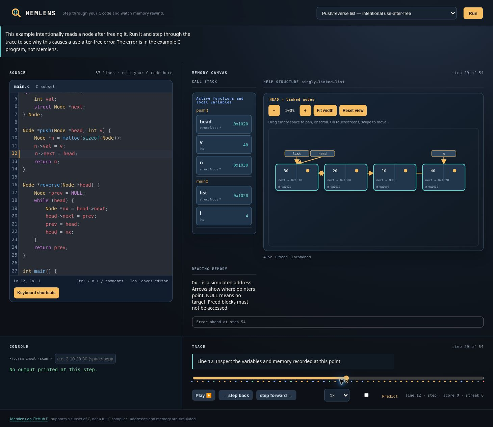
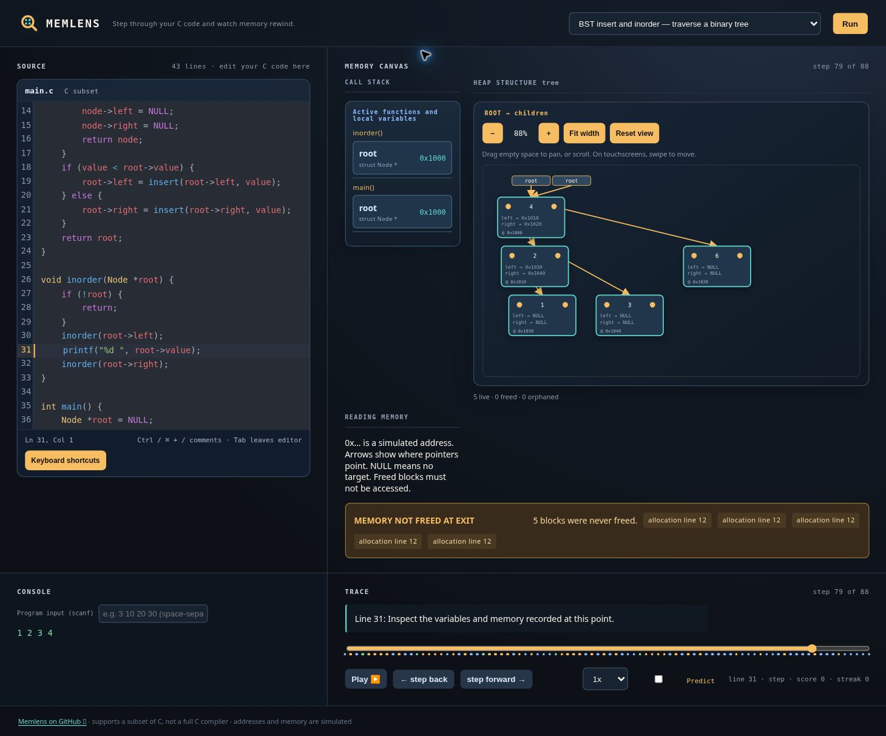

<p align="center">
  
</p>

<h1 align="center">Memlens</h1>
<p align="center"><strong>Step through your C code. See the pointers. Rewind the mistake.</strong></p>

**Main demo:** [memlensc.vercel.app](https://memlensc.vercel.app)  
**Alternate demo:** [memlens-six.vercel.app](https://memlens-six.vercel.app)

Memlens is a browser-based learning tool for C data structures and memory. Edit a program, run it, then explore its recorded execution one change at a time: stack frames, heap allocations, pointer arrows, and memory errors.

> **A teaching tool, not a full C compiler.** Memlens interprets a supported subset of C using simulated memory. It does not compile or execute native C, and its diagnostics can differ from gcc/clang or real hardware.

[Quick start](#try-it-in-a-minute) · [What you can explore](#what-you-can-explore) · [Controls](#controls) · [C support](#supported-c-subset) · [Run locally](#run-locally)

## See memory, not just output



*The list example at step 29: source, active stack frames, four allocated nodes, and the reversible timeline. Later, this sample deliberately accesses a freed node so you can trace how the bug happens.*

## Try it in a minute

1. Open the [main demo](https://memlensc.vercel.app) and choose a sample, or edit the C source.
2. If your program uses `scanf`, enter its values in **Program input**.
3. Click **Run** to record execution.
4. Step forward and backward. Watch the current explanation, console, call stack, and heap change together.
5. Zoom or pan the memory view to follow pointers. When an error appears, step backward to find what caused it.

## What you can explore

| Learn by doing | What Memlens shows |
| --- | --- |
| **Follow pointers** | Linked-list and binary-tree layouts, heap addresses, pointer arrows, and NULL targets. |
| **Understand execution** | Reversible steps, a timeline, call frames, console output, and playback speeds from 0.5× to 4×. |
| **Investigate memory bugs** | Diagnostics for invalid memory operations, freed-block markers, and reports of leaked or orphaned allocations. |
| **Practice data structures** | Bundled list, tree, stack, queue, recursion, and memory-error examples. |
| **Predict the next state** | Pointer-target questions with a locally saved score and streak. |
| **Write code here** | CodeMirror syntax highlighting, bracket matching, find/replace, undo/redo, and familiar editing shortcuts. |

<details>
<summary><strong>Explore a binary search tree</strong></summary>



The bundled BST sample during inorder traversal, with the diagram zoomed out to show every node. The amber warning is a whole-run summary: this sample does not free its five allocations before exit, even while you inspect an earlier step.

</details>

## Controls

| Where | Shortcut or control | Action |
| --- | --- | --- |
| Editor | Ctrl / ⌘ + `/` | Toggle comments on selected lines |
| Editor | Ctrl / ⌘ + `F` | Find and replace |
| Editor | Ctrl / ⌘ + `Z` / Ctrl / ⌘ + Shift + `Z` | Undo / redo |
| Editor | **Keyboard shortcuts** button | Open the full editing guide |
| Playback | `←` / `→` | Step backward / forward |
| Playback | `Space` | Play / pause |
| Playback | `Home` / `End` | Jump to the first / last step |
| Memory view | `−` / `+`, **Fit width**, **Reset view** | Adjust the diagram from 25% to 300% zoom |
| Memory view | Drag empty space, scroll, or swipe | Move around the diagram |

Playback shortcuts stay out of the editor and interactive controls. **Tab** moves focus between controls rather than trapping it inside the editor.

## Supported C subset

Designed for small C and data-structures exercises: functions and recursion, structs and pointers, fixed-size arrays (including two-dimensional arrays), loops, branching, and a selection of memory and input/output functions.

<details>
<summary><strong>Expand the language and library support reference</strong></summary>

The interpreter currently supports:

- Integer, character, `short`, `long`, `long long`, `unsigned`, `float`, `double`, `void`, `struct`, and typedef-defined struct names, with `struct Node *p` declarations.
- `const` and `static` qualifiers, multiple declarators, function prototypes, and the common `main` signatures.
- Pointer declarations, casts, pointer arithmetic, dereference, address-of, indexing, and pointer values.
- Pointer-to-pointer parameters and address-of expressions for variables, fields, and indexed elements.
- Struct declarations with fields, including pointer fields such as `next`, `left`, and `right`.
- Fixed-size `int` and `char` arrays, array initializers, array indexing, array parameters, two-dimensional arrays, and arrays of struct values.
- Struct values, the `.` operator, and passing struct addresses to functions.
- Variables, assignments (including chained assignment), compound assignments (`+=`, `-=`), arithmetic, comparisons, logical operators, the conditional operator (`?:`), unary `!`, unary `-`, dereference (`*`), address-of (`&`), and increment/decrement.
- Integer, character, string, and `NULL` literals.
- `if`/`else`, `while`, `do`/`while`, `for`, `break`, `continue`, and `switch`/`case`/`default`.
- User-defined functions, parameters, return values, and recursion.
- `malloc`, `calloc`, `realloc`, `free`, `sizeof` for supported types and expressions, `strlen`, `strcpy`, `strcmp`, `strcat`, `memset`, `getchar`, `exit`, and `printf` with `%d`, `%c`, `%s`, `%p`, `%f`, `%lf`, width, precision, and `%%`.
- `scanf` for `%d`, `%c`, and `%s` using the app's standard-input field, including repeated whitespace-separated input and indexed lvalue targets.
- Numeric and string `#define` constants. `#include` lines are accepted and ignored.
- `//` and `/* ... */` comments.

It does not currently support:

- Variable-length arrays and array features beyond the supported fixed-size scalar, struct, and two-dimensional arrays.
- Function pointers, unions, variadic functions, general pointer arithmetic beyond supported element indexing, and preprocessor directives other than numeric/string `#define` and ignored `#include`.
- The full C standard library or compilation with gcc/clang.

</details>

### Important limits

- This is a **subset interpreter**, not a standards-complete C implementation. Unsupported syntax or library calls may need a simpler equivalent.
- Variable-length arrays, function pointers, unions, and the full C preprocessor/library are not supported.
- Addresses and object sizes are simulated; the app is not a substitute for a native debugger or sanitizer.
- Diagram layouts infer structure from pointer fields and heap edges. Not every possible graph has a specialized layout.
- Source and Predict progress use browser localStorage, not an account or cloud sync. Browser storage can be cleared or unavailable.
- The production JavaScript bundle includes CodeMirror and currently triggers Vite's large-chunk warning.

## Run locally

Requires **Node.js compatible with Vite 6** and npm. Clone the repository, then run:

```sh
git clone https://github.com/gagang2109/Memlens.git
cd Memlens
npm ci
npm run dev
```

Open the local URL printed by Vite, usually [http://localhost:5173](http://localhost:5173).

On Windows PowerShell, use `npm.cmd` in place of `npm` if your execution policy blocks `npm.ps1`.

### Check a change

```sh
npm test
npm run typecheck
npm run build
```

- **Tests:** Vitest regression tests, including C lab fixtures in [`tests/labs`](tests/labs).
- **Typecheck:** TypeScript checks without emitting files.
- **Build:** Type-checks and creates the production site in `dist/`.

For Vercel, use the **Vite** preset, repository root `./`, build command `npm run build`, and output directory `dist`. The app has no backend, database, or server-side C execution.

## Under the hood

```text
C source → lexer/parser → interpreter + simulated memory → recorded trace → React visualizer
```

| Location | Responsibility |
| --- | --- |
| [`src/lang`](src/lang) | Lexer and parser for the supported C subset |
| [`src/vm`](src/vm) | Memory model, interpreter, trace data, and prediction logic |
| [`src/viz`](src/viz) | Heap reachability, structure detection, and layouts |
| [`src/ui`](src/ui) | Editor, explanations, diagrams, playback, and styles |
| [`src/samples.ts`](src/samples.ts) | Bundled sample programs |
| [`tests/labs`](tests/labs) | C exercises and regression coverage |

The byte-addressable memory model tracks initialized, uninitialized, and freed memory. Recorded steps retain the state needed to revisit stack frames, heap fields, output, and pointer relationships without executing native code.

## Found an example that behaves incorrectly?

[Open an issue](https://github.com/gagang2109/Memlens/issues) with the smallest C program that reproduces it, any program input, the expected result, and what Memlens actually shows. Mention your browser and include a screenshot when the problem is visual. Remove personal data before sharing.

## Possible future directions

Function pointers, unions, a bit-level memory view, shareable links, and image/GIF export are ideas for future work, **not current features**.

## License

[MIT](LICENSE) · Copyright © 2026 Gagan Ganesh Devadiga
